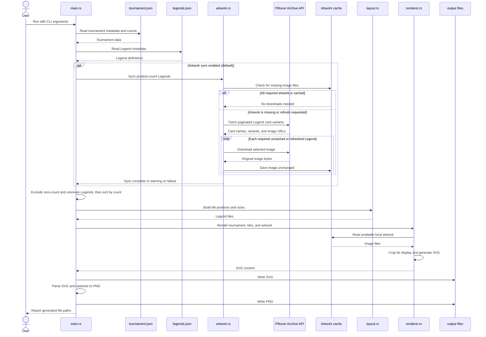

# Riftbound Meta Generator

This Rust command-line program reads tournament and Legend metadata from JSON, optionally downloads missing Legend artwork from Piltover Archive, and generates a 1920×1080 PNG and SVG meta breakdown.

The output includes the tournament name and player count, and shows the tournament date when one is provided. Only Legends with counts greater than zero are included in the output or considered for artwork downloads.

## Requirements

- Rust and Cargo: https://www.rust-lang.org/tools/install
- Internet access to download artwork that is not already cached (unless using `--skip-artwork`)

## Run

From the project directory:

```powershell
cargo run
```

## Tests

Run all unit and command-line integration tests with:

```powershell
cargo test
```

All tests use local fixtures and run offline. They cover CLI help and input
errors; SVG/PNG generation and dimensions; output path handling; filtering and
ordering; tournament and Legend text escaping; layout boundaries and overlap;
faction colors; artwork cropping, variant selection, cache use, and error
handling. They do not call Piltover Archive, so API availability and remote
downloads are not validated by `cargo test`.

Optional formatting and lint checks:

```powershell
cargo fmt --check
cargo clippy --all-targets -- -D warnings
```

The program uses fixed data folders and accepts filenames rather than paths.
By default, it reads `tournament.json` from
`../DataFiles/RiftboundTournaments` and `data/legends.json` from the project,
then writes:

- PNG: `../DataFiles/RiftboundTournaments/TournamentOutput/meta.png`
- SVG: `../DataFiles/RiftboundTournaments/TournamentOutput/meta.svg`

All relative paths are resolved from the current working directory.

## Command-line options

Run `cargo run -- --help` to see the CLI help. The available arguments are:

| Argument | Default | Purpose |
|---|---|---|
| `tournament` | `tournament.json` | Tournament JSON filename, read from `../DataFiles/RiftboundTournaments` |
| `--output` | `meta.png` | PNG filename, written to `../DataFiles/RiftboundTournaments/TournamentOutput` |
| `--svg` | PNG filename with `.svg` extension | Optional SVG filename, written to the same output folder |
| `--skip-artwork` | Off | Do not contact Piltover Archive; render using local artwork only |
| `--refresh-artwork` | Off | Re-download artwork for positive-count tournament Legends, even if cached |

Tournament and output arguments must be filenames only; directory paths are
rejected. The tournament database and artwork cache locations are fixed at
`data/legends.json` and `../DataFiles/RiftboundAssets/legends`.

Examples:

```powershell
# Use the default tournament.json and meta.png/meta.svg names
cargo run

# Use a different tournament filename and output filenames
cargo run -- weekly-event.json --output weekly-meta.png --svg weekly-meta.svg

# Render offline from the configured artwork cache
cargo run -- --skip-artwork

# Force artwork downloads for Legends with counts greater than zero
cargo run -- --refresh-artwork
```

## Input data

The selected tournament file (by default
`../DataFiles/RiftboundTournaments/tournament.json`) contains a `tournament`
object with:

- `name`: tournament name
- `date`: optional date string; an empty string omits the date from the output
- `players`: player count

It also contains a `legends` object mapping Legend IDs to tournament counts. Counts of zero are excluded from both the rendered output and artwork synchronization.

`data/legends.json` maps those IDs to Legend metadata: `name`, `title`, `image`,
and `faction`. Counts are supplied in the tournament file; they are not fetched
from Piltover Archive. Faction names must exactly match the configured names
(for example, use `Void`, not `The Void`); unrecognized names use the default
accent color.

Example tournament file:

```json
{
  "tournament": {
    "name": "Local Skirmish",
    "date": "2026-10-31",
    "players": 16
  },
  "legends": {
    "ahri_ogn": 4,
    "darius_ogn": 2
  }
}
```

Example Legend metadata:

```json
{
  "ahri_ogn": {
    "name": "Ahri",
    "title": "The Fox",
    "image": "ahri_ogn.png",
    "faction": "Ionia"
  }
}
```

`date` and `players` may be omitted; they default to no date and zero players.
Legends with zero counts are ignored. Positive-count IDs missing from
`legends.json` are skipped with a warning.

## Artwork behavior

By default, artwork is synchronized only for tournament Legends whose count is greater than zero and whose image is not already present in the configured cache. Cached images are reused on later runs. `--refresh-artwork` forces a new download for the positive-count Legends, and `--skip-artwork` disables synchronization entirely.

The program requests paginated card data from `https://piltoverarchive.com/api/external/v1/cards`, matches card names to the local Legend metadata, and prefers the set indicated by the image filename when possible. It downloads the selected image unchanged into the cache; display cropping is applied during rendering, not to the cached image.

If artwork synchronization fails, the program prints a warning and continues
with any cached artwork. A tile whose image is missing renders without that
image; an existing but unreadable or corrupt image causes rendering to fail.
The external API is community-documented, not an official stable contract, and
may change. Check Piltover Archive's terms and applicable Riot Games policies
before redistributing card artwork.

## Project structure

```text
riftbound_metadata/
├── Cargo.toml
├── Cargo.lock
├── README.md
├── src/
│   ├── main.rs
│   ├── config.rs
│   ├── models.rs
│   ├── layout.rs
│   ├── renderer.rs
│   └── artwork.rs
├── tests/
│   ├── cli.rs
│   ├── cli/
│   │   ├── arguments.rs
│   │   ├── common.rs
│   │   ├── errors.rs
│   │   └── generation.rs
│   └── unit/
│       ├── artwork.rs
│       ├── config.rs
│       ├── entrypoint.rs
│       ├── layout.rs
│       └── renderer.rs
├── data/
│   └── legends.json
```

Tournament JSON files are read from
`../DataFiles/RiftboundTournaments`; only the filename is supplied on the
command line. The artwork cache is at
`../DataFiles/RiftboundAssets/legends`. Generated PNG and SVG files are written
to `../DataFiles/RiftboundTournaments/TournamentOutput`; only their filenames
are supplied on the command line.

## Program architecture

`main.rs` parses arguments and coordinates the workflow. It loads the JSON
inputs, optionally synchronizes missing artwork, filters and sorts Legends,
builds the tile layout, writes the SVG, and rasterizes it to PNG. The rendering
and artwork-sync failures are reported with context; artwork-sync failures are
warnings so rendering can continue with cached files.

Unit tests are stored under `tests/unit/` and included by their corresponding
source modules when testing. End-to-end CLI tests are grouped under
`tests/cli/`.


